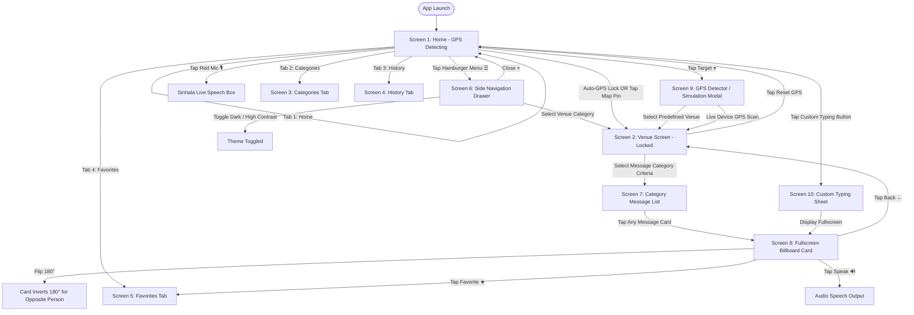

# ASSISTCOMM AI COMMUNICATION ASSISTANT
## Complete Design Specification & UI Architecture Reference

> **Document Version:** 1.0.0  
> **Target Platform:** Web (Flask/Jinja2/Vanilla CSS) & Flutter Mobile Client  
> **Source References:**  
> - Visual Reference: Screenshots in `original screens/` (`home.png`, `hospital.png`, `bank.png`, `restaurant.png`, `supermarket.png`)  
> - Source Templates: `app/templates/` (`mobile.html`, `card_view.html`, `location.html`, `index.html`, `base.html`)  
> - Style Assets: `app/static/css/` (`design_system.css`, `mobile.css`, `components.css`, `style.css`)  
> - Phrase Dataset: `original screens/phrases.csv`, `original screens/dataset.docx`, `backend/app/routes/api.py`

---

## 1. System Overview & Core User Flows

AssistComm is an accessible bilingual communication assistant designed specifically for deaf, hard-of-hearing, and non-verbal individuals in Sri Lanka. It pairs real-time GPS location detection with context-aware communication criteria (Hospital, Bank, Restaurant, Supermarket, Pharmacy, and General/Everyday situations).

### Navigation & State Flow Diagram

---

## 2. Comprehensive Screen-by-Screen Specifications

### Screen 1: Home Screen (GPS Detecting / Unlocked State)
*Visual Reference: `original screens/home.png`*

#### 1. Top Status Bar (Smartphone Simulation Frame)
* **Left Time:** `9:41` / `13:33` (tabular bold numbers)
* **Center Dynamic Island / Notch:** 96px × 22px black pill with camera lens dot
* **Right Status Icons:** Signal strength bars (`●●●○`), Wi-Fi waves, Battery pill (`100%`)

#### 2. App Header (Navigation Bar)
* **Left Button:** Hamburger menu button (`☰` / `fa-bars`, 38×38 circular transparent button)
* **Center Title:** `AI Communication Assistant` (Font: Outfit 17px, boldest 700/800, `#0F172A`)
* **Right Actions:**
  * Red Circular Microphone Button: 38×38 circle, background `#EF4444`, white mic icon (`fa-microphone`)
  * GPS Target Bullseye Button: 38×38 circle, icon `fa-bullseye` / `fa-crosshairs`, `#0F172A`

#### 3. Floating GPS Scan Toast (`gps-scan-toast`)
* **Container:** Floating dark rounded pill (`#0F172A`, border-radius 14px, shadow `0 10px 25px rgba(0,0,0,0.3)`)
* **Spinner:** Glowing cyan radar circle (`width: 24px, height: 24px`, border `3px solid rgba(56, 189, 248, 0.3)`, border-top `#38BDF8`, animation `spinRadar 0.8s linear infinite`)
* **Text Label:** `Acquiring GPS satellite coordinates...` (white `#FFFFFF`, font size 13px, font weight 600)

#### 4. Location Hero Card (`location-hero-card`)
* **Avatar Container:** 44×44 rounded-square (radius 14px), background `#FFE4E6`, icon red map pin (`fa-location-dot` / `fa-location-pin`, `#F43F5E`)
* **Eyebrow Row:**
  * Left: `CURRENT LOCATION` (10px uppercase, bold 700, letter-spacing 0.8px, `#64748B`)
  * Right: `[H] 20 SL Hospitals` (pill badge, background `#FEE2E2`, text `#EF4444`, font size 10px bold)
* **Main Title:** `Detecting Location...` (Outfit 17px, extra bold 800, `#0F172A`)
* **Subtitle Row:**
  * Left: `Detected via GPS` (11px, `#64748B`)
  * Right: `● LIVE` badge pill (white background, border `#CBD5E1`, dark dot `#0F172A`, bold uppercase text `LIVE`)

#### 5. Interactive Area Map Card (`area-map-card`)
* **Map Viewport:** OpenStreetMap canvas showing roads, coastline, and Colombo landmarks (230px height, expandable)
* **Top Floating Instruction Badge:**
  * Text: `Hospitals (Red) • Banks (Blue) • Restaurants (Amber) • Supermarkets (Green) • Tap pin to select`
  * Styling: Dark rounded pill `#0F172A`, colored icon glyphs:
    * `Hospitals (Red)`: `#EF4444` (`fa-square-h`)
    * `Banks (Blue)`: `#2563EB` (`fa-building-columns`)
    * `Restaurants (Amber)`: `#F59E0B` (`fa-utensils`)
    * `Supermarkets (Green)`: `#10B981` (`fa-cart-shopping`)
* **Left Zoom Controls:** Leaflet-style stacked white rounded buttons: `+` (Zoom in) and `-` (Zoom out)
* **Right Floating Controls (Vertical Stack):**
  1. Recenter GPS Button (`fa-crosshairs`, `#1E293B`)
  2. Hospitals Filter Button (`fa-square-h`, `#EF4444`)
  3. Banks Filter Button (`fa-building-columns`, `#2563EB`)
  4. Restaurants Filter Button (`fa-utensils`, `#F59E0B`)
  5. Supermarkets Filter Button (`fa-cart-shopping`, `#10B981`)
  6. Colombo Focus Button (`fa-hospital` / `fa-location-city`, `#6366F1`)
  7. Toggle Expand Map Button (`fa-chevron-up`, `#475569`)
* **Pins on Map:** White rounded pills with category icon circle and border matching category color:
  * Red: `Nawaloka Hospital`, `NHSL Colombo`, `LRH Children's Hospital`
  * Blue: `Standard Chartered Fort`, `People's Bank HQ`, `Seylan Towers Colombo`, `Commercial Bank HQ`, `NSB Head Office`, `DFCC Bank HQ`
  * Amber: `Kaema Sutra`, `Hotel de Pilawoos`, `Raja Bojun`
  * Green: `Keells Super`, `Cargills Food City`
* **Bottom Strip (`map-hospital-selector-strip`):**
  * Header Title: `Select on Map (🔴 Hospitals | 🔵 Banks | 🟠 Restaurants | 🟢 Supermarkets):`
  * Right Badge: `Tap Pin on Map` (`#FEE2E2` bg, `#EF4444` text) + circular chevron up `^`
  * Horizontal Venue Pills: Scrollable pills for each venue with category icon and short title
* **Status Footer:** `ℹ Acquiring area coordinates and nearby venues...` (`#64748B`, 11px)

#### 6. Center State Card (When GPS is searching)
* **Icon:** Circular soft pink container (`#FFE4E6`) with red target/radar icon (`#F43F5E`)
* **Heading:** `GPS Detection Active` (bold 16px `#0F172A`)
* **Body Text:**  
  `Select a hospital (🔴), bank (🔵), restaurant (🟠), or supermarket (🟢) on the map, or wait for GPS to detect your location to view message categories.`

#### 7. Bottom Navigation Bar (`mobile-bottom-nav`)
* Fixed 4-tab bar (White background, top border `#E2E8F0`, 60px height)
* Items:
  1. **Home:** `fa-house` / `Icons.home`, label: `Home` (Active: `#0F172A` / `#2563EB`)
  2. **Categories:** `fa-border-all` / `Icons.grid_view`, label: `Categories`
  3. **History:** `fa-clock-rotate-left` / `Icons.history`, label: `History`
  4. **Favorites:** `fa-star` / `Icons.star`, label: `Favorites`
* iOS Home indicator bar: 134×5px rounded black bar at the very bottom center.

---

### Screen 2: Venue / Location Locked Screens
*Visual References: `hospital.png`, `bank.png`, `restaurant.png`, `supermarket.png`*

When GPS locks onto a facility or a user selects a venue pin, the screen dynamically switches the theme, icons, badges, and category buttons.

#### Common Structure Across All Venues:
1. **GPS Sub-Header Strip (`gps-live-strip`):**
   * Green dot indicator (`#10B981`)
   * Status Text: `● GPS Locked: [Venue Name] (±5m)`
   * Action Button: `Reset GPS` (`fa-arrows-rotate`, rounded blue-tinted button)
2. **Location Hero Card:**
   * Eyebrow: `[VENUE_TYPE] SELECTED FROM MAP • සිතියමෙන් තෝරාගත් [ස්ථානය]`
   * Title: Specific Venue Name (e.g., `Asiri Surgical Hospital`, `Pan Asia Bank - Head Office`, `Hotel de Pilawoos`, `Keells Super - Rajagiriya`)
   * Subtitle: Full postal address (e.g., `Asiri Surgical Hospital, Kirimandala Mw, Narahenpita, Colombo 05, Colombo District`)
   * Right Badge: `MAP - HOSPITAL` / `MAP - BANK` / `MAP - RESTAURANT` / `MAP - SUPERMARKET`
3. **Map Viewport:**
   * Centered precisely on the venue's latitude and longitude with a highlighted pulsating marker
   * Footer Status: `✔ Inside [Category]: [Venue Name]` with green checkmark icon
4. **Section Heading:**
   * Title: `[Category Icon] [Category Name] Message Criteria / [Sinhala Name] කාණ්ඩ`
   * Badge: `[N] Categories` (e.g., `9 Categories` or `10 Categories`)
   * Sub-instruction: `👆 Press a category button above to suggest communication messages`

---

#### Venue 1: Hospital (`hospital.png`)
* **Theme Color:** Crimson Red (`#EF4444` / `#E11D48`) | Background Tint: `#FFE4E6`
* **Badge:** `20 SL Hospitals`
* **Section Title:** `Hospital Message Criteria / රෝහල් කාණ්ඩ` | Badge: `9 Categories`
* **9 Category Buttons (Full width with item count badge and right chevron `>`):**
  1. `1. මූලික සන්නිවේදනය / Basic communication` [Count: 10] (Red `#E11D48`)
  2. `2. පිළිගැනීම සහ ලියාපදිංචිය / Reception and registration` [Count: 10] (Blue `#0284C7`)
  3. `3. දිශාවන් / Directions` [Count: 10] (Emerald `#059669`)
  4. `4. රෝග ලක්ෂණ / Symptoms` [Count: 15] (Amber `#D97706`)
  5. `5. හදිසි අවස්ථා / Emergency` [Count: 8] (Crimson `#DC2626`)
  6. `6. වෛද්‍ය ඉතිහාසය / Medical history` [Count: 14] (Indigo `#4F46E5`)
  7. `7. වෛද්‍ය උපදේශනය / Doctor consultation` [Count: 14] (Teal `#0D9488`)
  8. `8. ක්‍රියාපටිපාටි සහ පහසුව / Procedures and comfort` [Count: 8] (Purple `#9333EA`)
  9. `9. ඖෂධ ශාලාව, බිල්පත් කිරීම සහ බැහැර කිරීම / Pharmacy, billing and discharge` [Count: 9] (Cyan `#0891B2`)

---

#### Venue 2: Bank (`bank.png`)
* **Theme Color:** Royal Blue (`#2563EB`) | Background Tint: `#DBEAFE`
* **Badge:** `12 SL Banks`
* **Section Title:** `Bank Message Criteria / බැංකු කාණ්ඩ` | Badge: `10 Categories`
* **10 Category Buttons (All Royal Blue `#2563EB` gradient cards):**
  1. `1. මූලික සන්නිවේදනය / Basic communication` [Count: 7]
  2. `2. පිළිගැනීමේ අංශය සහ පෝලිම / Reception and queue` [Count: 8]
  3. `3. ගිණුමක් විවෘත කිරීම / Opening an account` [Count: 12]
  4. `4. තැන්පත් කිරීම් සහ මුදල් ආපසු ගැනීම් / Deposits and withdrawals` [Count: 12]
  5. `5. කාඩ්පත් සහ ATM / Cards and ATM` [Count: 12]
  6. `6. ණය / Loans` [Count: 12]
  7. `7. මාරු කිරීම් සහ ගෙවීම් / Transfers and payments` [Count: 10]
  8. `8. ගිණුම් සේවා සහ ගැටළු / Account services and problems` [Count: 12]
  9. `9. ආරක්ෂාව සහ වංචා / Security and fraud` [Count: 6]
  10. `10. ආචාරශීලී වදන් සහ සමුගැනීම / Closing and courtesy` [Count: 6]

---

#### Venue 3: Restaurant (`restaurant.png`)
* **Theme Color:** Warm Amber (`#F59E0B` / `#D97706`) | Background Tint: `#FEF3C7`
* **Badge:** `10 SL Restaurants`
* **Section Title:** `🍴 Restaurant Message Criteria / ආපනශාලා කාණ්ඩ` | Badge: `9 Categories`
* **9 Category Buttons (Warm Amber / Orange `#F59E0B` cards):**
  1. `1. මූලික සන්නිවේදනය / Basic communication` [Count: 10]
  2. `2. පැමිණීම සහ අසුන් ගැනීම / Arrival and seating` [Count: 12]
  3. `3. මෙනුව සහ ඇණවුම් කිරීම / Menu and ordering` [Count: 18]
  4. `4. බීම වර්ග / Drinks` [Count: 10]
  5. `5. ආහාර අවශ්‍යතා සහ ආසාත්මිකතා / Dietary needs and allergies` [Count: 14]
  6. `6. කෑම රිසිකරණය / Customizing the food` [Count: 12]
  7. `7. කෑම ගන්නා අතරතුර / During the meal` [Count: 10]
  8. `8. රැගෙන යාම සහ විශේෂ ඉල්ලීම් / Takeaway and special requests` [Count: 6]
  9. `9. බිල සහ ගෙවීම් / Bill and payment` [Count: 8]

---

#### Venue 4: Supermarket (`supermarket.png`)
* **Theme Color:** Fresh Emerald Green (`#10B981` / `#059669`) | Background Tint: `#DCFCE7`
* **Badge:** `10 SL Supermarkets`
* **Section Title:** `🛒 Supermarket Message Criteria / සුපිරි වෙළඳසැල් කාණ්ඩ` | Badge: `9 Categories`
* **9 Category Buttons (Emerald Green `#10B981` cards):**
  1. `1. මූලික සන්නිවේදනය / Basic communication` [Count: 10]
  2. `2. ආධාර සහ පහසුකම් ලබා ගැනීම / Getting help and facilities` [Count: 10]
  3. `3. නිෂ්පාදන සොයා ගැනීම / Finding products` [Count: 20]
  4. `4. මිල ගණන් සහ දීමනා / Prices and offers` [Count: 10]
  5. `5. නිෂ්පාදන තොරතුරු සහ ආහාරමය අවශ්‍යතා / Product information and dietary needs` [Count: 12]
  6. `6. බර කිරා බැලීම, කැපීම සහ ඇසුරුම් කිරීම / Weighing, cutting and packing` [Count: 8]
  7. `7. පිටවීම සහ ගෙවීම / Checkout and payment` [Count: 14]
  8. `8. නිෂ්පාදන ආපසු යැවීම / Problems and returns` [Count: 6]
  9. `9. සමාප්තිය සහ ආචාරශීලීත්වය / Closing and courtesy` [Count: 4]

---

### Screen 3: Categories Tab (`tab-categories`)
*Visual Reference: `mobile.html` lines 894-1013*

* **Heading:** `Browse Categories`
* **Sinhala Live Speech Box Component:**
  * Header: Pulsing mic icon, `Sinhala Live Speech Box`, subtitle `සජීවී සිංහල හඬ හඳුනාගැනීම (si-LK)`, green live dot + `Auto-Detecting (ස්වයංක්‍රීය සවන්දීම)`
  * Visualizer: 8 animated green/accent equalizer bars
  * Transcript Box: Placeholder `කතා කරන්න, සජීවීව හඳුනාගැනේ... (Speak now, auto-detecting what you say...)`
  * Action Toolbar (when speech detected): `Show Fullscreen` (`fa-expand`), `Suggest Phrases` (`fa-wand-magic-sparkles`), `Clear` (`fa-trash-can`)
* **Predefined Facilities Selection Cards (`cat-item-card`):**
  1. **Supermarket & Groceries:**
     * Icon: `fa-cart-shopping` (Green circle `#D1FAE5`, icon `#10B981`)
     * Description: `Finding items, pricing, staff help, checkout counter`
  2. **Popular Restaurant & Dining:**
     * Icon: `fa-utensils` (Amber circle `#FEF3C7`, icon `#F59E0B`)
     * Description: `Viewing menu, ordering meals, allergies, requesting bill`
  3. **Bank & Financial Services:**
     * Icon: `fa-building-columns` (Blue circle `#DBEAFE`, icon `#2563EB`)
     * Description: `Cash withdrawals, deposits, teller help, ATM directions`
  4. **Hospital & Healthcare:**
     * Icon: `fa-hospital` (Pink circle `#FFE4E6`, icon `#F43F5E`)
     * Description: `Emergency care, appointments, doctor visits, directions`
  5. **Pharmacy & Medicine:**
     * Icon: `fa-prescription-bottle-medical` (Purple circle `#EDE9FE`, icon `#8B5CF6`)
     * Description: `Prescriptions, cold medicine, first aid, dosage guide`
  6. **Outside Predefined Facilities:**
     * Icon: `fa-location-dot` (Indigo circle `#E0E7FF`, icon `#6366F1`)
     * Description: `Everyday situations: Cannot speak, need help, restroom, write down`

---

### Screen 4: History Tab (`tab-history`)
*Visual Reference: `mobile.html` lines 1016-1098*

* **Header:** `Recent Messages`
* **Clear Action:** `Clear All` button (red text `#EF4444`, 12px bold)
* **Sinhala Live Speech Box:** Integrated live recognition box
* **Empty State:**
  * Icon: `fa-clock-rotate-left` (large muted icon `#94A3B8`)
  * Text:  
    `No messages displayed yet.`  
    `Tap any card to view and speak it.`
* **Populated State:** Reverse chronological list of messages displayed on fullscreen card. Each card has:
  * Sinhala message text (bold 15px)
  * English translation (13px `#64748B`)
  * Relative timestamp (`Just now`, `5m ago`, etc.)
  * Quick Re-display button (`fa-expand`) and Speak button (`fa-volume-high`)

---

### Screen 5: Favorites Tab (`tab-favorites`)
*Visual Reference: `mobile.html` lines 1101-1184*

* **Header:** `Favorite Messages`
* **Clear Action:** `Clear All` button (red text `#EF4444`, 12px bold)
* **Sinhala Live Speech Box:** Integrated live recognition box
* **Empty State:**
  * Icon: `fa-star` (large gold/muted icon `#E2E8F0`)
  * Text:  
    `No favorites saved yet.`  
    `Tap the star icon on any card to save it here for quick access.`
* **Populated State:** List of starred phrases with instant one-tap fullscreen display.

---

### Screen 6: Hamburger Menu Side Navigation Drawer
*Visual Reference: `mobile.html` lines 1328-1380, `mobile.css` lines 1040-1125*

* **Backdrop:** Semi-transparent dark overlay (`rgba(15, 23, 42, 0.6)`)
* **Drawer Panel:** Slides in from left, width 300px, background `#0F172A`, text `#FFFFFF`
* **Drawer Header:**
  * Brand Logo: `fa-hands-asl-interpreting` + Title `AssistComm`
  * Close Button: `×` (`btn-close-sheet`, 32×32 circular button)
* **Section 1: Predefined Locations**
  * Supermarket & Groceries (`fa-cart-shopping`, Green `#10B981`)
  * Popular Restaurant & Dining (`fa-utensils`, Amber `#F59E0B`)
  * Bank & Financial Services (`fa-building-columns`, Blue `#2563EB`)
  * Hospital & Healthcare (`fa-hospital`, Red `#EF4444`)
  * Pharmacy & Medicine (`fa-prescription-bottle-medical`, Purple `#8B5CF6`)
  * Outside Predefined Facilities (`fa-location-dot`, Indigo `#6366F1`)
* **Section 2: Accessibility & Theme**
  * `High Contrast Mode` toggle (`fa-circle-half-stroke`)
  * `Dark Mode` toggle (`fa-moon`)
* **Section 3: Application**
  * `Web Dashboard` link (`fa-house`)
  * `About AssistComm` button (`fa-circle-info`)
    * About Dialog text: `AssistComm AI Communication Assistant v2.0 - Designed for deaf and non-verbal accessibility with GPS location awareness for Hospitals, Supermarkets, Restaurants, and Banks.`

---

### Screen 7: Message List & Category Criteria
*Visual Reference: `location.html`, `mobile.html` lines 308-880*

When a category button (e.g., `Basic communication` or `Symptoms`) is tapped, it displays the list of communication phrase cards.

#### Elements:
* **Section Title:** `Select a Message` (Outfit 17px `#0F172A`)
* **Category Badge:** `[Venue] Phrases` (e.g. `Hospital Phrases`)
* **Message Cards List:** 
  * Full width cards, white background, border `1.5px solid #CBD5E1`, border-radius 14px
  * Sinhala Text: 16px boldest 800 (`#0F172A`), high-contrast rendering
  * English Text: 13.5px medium 500 (`#64748B`)
  * Audio Speaker Icon: Blue volume icon (`fa-volume-high`)
  * Expand/Fullscreen Icon: (`fa-expand`)
* **Dynamic Slot Fill-in Cards:**
  * For messages with customizable slots (e.g. `Where is the {slot}?` / `{slot} කොහෙද?`):
  * Input field with placeholder: `Type item name here...`
  * Action button: `Show Card` (`fa-expand`)

---

### Screen 8: Fullscreen Billboard Communication Card
*Visual Reference: `card_view.html` and `mobile.html` lines 1297-1327*

This is the primary communication card displayed to cashiers, nurses, bank tellers, or doctors. It takes over the screen to present large, legible text that can be rotated 180° for the person standing or sitting across the counter.

#### Elements & Layout:
* **Background:** High-contrast Dark Slate/Black (`#000000` or `#0F172A`)
* **Top Toolbar (`billboard-toolbar`):**
  * Left Back Button: `← Back` (white border pill button)
  * Right Action Buttons:
    1. **Flip 180° Button:** `Flip 180°` (`fa-rotate`) — Inverts the text card 180° (`transform: rotate(180deg)`)
    2. **Speak Button:** `Speak` (`fa-volume-high`) — Speaks the message via SpeechSynthesis
    3. **Favorite Button:** `Favorite` (`fa-star`) — Stars the message
* **Card Center (`billboard-card`):**
  * Icon: 64px illuminated category icon (`#FFEE00` in high contrast or `#38BDF8` in dark mode)
  * **Sinhala Primary Text:** 
    * Font: Inter / System Sinhala font
    * Size: 28px - 36px (`clamp(2.2rem, 5.2vw, 4.4rem)`)
    * Weight: 800 ExtraBold
    * Color: High-visibility Yellow `#FFEE00` or White `#FFFFFF`
    * Text Shadow: `0 0 25px rgba(255, 238, 0, 0.35)`
  * **Divider Line:** 72px width × 3px height yellow pill divider
  * **English Secondary Text:**
    * Font: Outfit 22px - 28px (`clamp(1.8rem, 4.2vw, 3.6rem)`)
    * Weight: 800 ExtraBold
    * Color: Clean White `#FFFFFF`
    * Letter-spacing: `-0.02em`

---

### Screen 9: GPS Location Detector & Simulation Modal
*Visual Reference: `mobile.html` lines 1216-1263*

* **Header:** `GPS Location Detector` (`fa-location-crosshairs`) + Close button `×`
* **Description:** `Detect your nearby facility automatically via GPS or choose a predefined place to simulate real-time positioning:`
* **Primary Button:** `Detect via Live Device GPS` (`fa-satellite-dish`, Blue button `#2563EB`)
* **Divider:** `OR DETECT PREDEFINED LOCATIONS`
* **2x2 Grid of Simulation Buttons:**
  * Hospital (`#FFE4E6` icon bg, `#F43F5E` red icon)
  * Supermarket (`#D1FAE5` icon bg, `#10B981` green icon)
  * Restaurant (`#FEF3C7` icon bg, `#F59E0B` amber icon)
  * Bank (`#DBEAFE` icon bg, `#2563EB` blue icon)

---

### Screen 10: Custom Typing Bottom Sheet / Modal
*Visual Reference: `mobile.html` lines 1266-1294, `location.html` lines 117-137*

* **Header:** `Custom Typing` (`fa-pencil`) + Close button `×`
* **Textarea Input:** `Type your custom message here...` (or `e.g. I need to find the children's section.`)
* **Quick Suggestion Chips Row:**
  1. `Yes / ඔව්` (`data-text="Yes"`, `data-text-si="ඔව්."`)
  2. `No / නැහැ` (`data-text="No"`, `data-text-si="නැහැ."`)
  3. `Please write it down / ලියන්න` (`data-text="Please write it down"`, `data-text-si="කරුණාකර ඔබේ පණිවිඩය ලියන්න."`)
  4. `I am deaf / මම බිහිරි` (`data-text="I am deaf / hard of hearing"`, `data-text-si="මම බිහිරි කෙනෙක්."`)
  5. `Thank you / ස්තූතියි` (`data-text="Thank you"`, `data-text-si="ස්තූතියි."`)
* **Action Buttons:**
  * Primary: `Display Fullscreen` (`fa-expand`, Blue button `#2563EB`)
  * Secondary: `Speak` (`fa-volume-high`, white outlined button)

---

## 3. Bilingual Label Master Table (Exact English & Sinhala Wording)

### Navigation, System & UI Controls
| English Label | Sinhala Label (Exact Wording) | Context / Placement |
| :--- | :--- | :--- |
| **AI Communication Assistant** | **AI සන්නිවේදන සහායක** | App Header Bar |
| **CommAssist Sri Lanka** | **කොම්ඇසිස්ට් ශ්‍රී ලංකා** | App Header Subtitle |
| **CURRENT LOCATION** | **වත්මන් ස්ථානය** | Hero Card Eyebrow |
| **Detecting Location...** | **ස්ථානය හඳුනාගනිමින්...** | Hero Card Title (searching) |
| **Detected via GPS** | **GPS මඟින් හඳුනාගන්නා ලදී** | Hero Card Subtitle (auto) |
| **Selected Manually** | **සිතියමෙන් තෝරාගත් ස්ථානය** | Hero Card Subtitle (manual) |
| **LIVE** | **සජීවී** | Hero Card Status Badge |
| **GPS Detection Active** | **GPS හඳුනාගැනීම සක්‍රියයි** | Home Center Prompt Title |
| **Hospitals (Red)** | **රෝහල් (රතු)** | Map Instruction Badge |
| **Banks (Blue)** | **බැංකු (නිල්)** | Map Instruction Badge |
| **Restaurants (Amber)** | **ආපනශාලා (ඇම්බර්)** | Map Instruction Badge |
| **Supermarkets (Green)** | **සුපිරි වෙළඳසැල් (කොළ)** | Map Instruction Badge |
| **Tap pin to select** | **තේරීමට පින් එක ස්පර්ශ කරන්න** | Map Instruction Badge |
| **Select on Map** | **සිතියමෙන් තෝරන්න** | Map Venue Strip Header |
| **Tap Pin on Map** | **සිතියමෙන් පින් එක තෝරන්න** | Map Venue Strip Badge |
| **Acquiring area coordinates and nearby venues...** | **ප්‍රදේශයේ ඛණ්ඩාංක සහ ආසන්න ස්ථාන ලබාගනිමින්...** | Map Status Bar Footer |
| **Select a Message** | **පණිවිඩයක් තෝරන්න** | Main Phrases Grid Header |
| **Custom Typing** | **අභිරුචි ටයිප් කිරීම** | Custom Message Card |
| **Browse Categories** | **කාණ්ඩ පිරික්සන්න** | Categories Tab Header |
| **Recent Messages** | **මෑතකදී භාවිතා කළ පණිවිඩ** | History Tab Header |
| **Favorite Messages** | **ප්‍රියතම පණිවිඩ** | Favorites Tab Header |
| **Clear All** | **සියල්ල මකන්න** | History & Favorites Action |
| **Back** | **ආපසු** | Fullscreen Card Toolbar |
| **Flip View (180°)** | **180° හරවන්න** | Fullscreen Card Toolbar |
| **Speak** | **හඬ නඟා කියවන්න** | Speech Audio Button |
| **Favorite** | **ප්‍රියතම** | Star Message Button |
| **Display Fullscreen** | **සම්පූර්ණ තිරයේ පෙන්වන්න** | Fullscreen Card Launch |

---

### Category Titles Across Predefined Venues
| English Category Name | Sinhala Category Name (Exact Wording) | Venue Type | Item Count |
| :--- | :--- | :--- | :--- |
| **Basic communication** | **මූලික සන්නිවේදනය** | Hospital, Bank, Restaurant, Supermarket | 7 - 10 |
| **Reception and registration** | **පිළිගැනීම සහ ලියාපදිංචිය** | Hospital | 10 |
| **Directions** | **දිශාවන්** | Hospital | 10 |
| **Symptoms** | **රෝග ලක්ෂණ** | Hospital | 15 |
| **Emergency** | **හදිසි අවස්ථා** | Hospital | 8 |
| **Medical history** | **වෛද්‍ය ඉතිහාසය** | Hospital | 14 |
| **Doctor consultation** | **වෛද්‍ය උපදේශනය** | Hospital | 14 |
| **Procedures and comfort** | **ක්‍රියාපටිපාටි සහ පහසුව** | Hospital | 8 |
| **Pharmacy, billing and discharge** | **ඖෂධ ශාලාව, බිල්පත් කිරීම සහ බැහැර කිරීම** | Hospital | 9 |
| **Reception and queue** | **පිළිගැනීමේ අංශය සහ පෝලිම** | Bank | 8 |
| **Opening an account** | **ගිණුමක් විවෘත කිරීම** | Bank | 12 |
| **Deposits and withdrawals** | **තැන්පත් කිරීම් සහ මුදල් ආපසු ගැනීම්** | Bank | 12 |
| **Cards and ATM** | **කාඩ්පත් සහ ATM** | Bank | 12 |
| **Loans** | **ණය** | Bank | 12 |
| **Transfers and payments** | **මාරු කිරීම් සහ ගෙවීම්** | Bank | 10 |
| **Account services and problems** | **ගිණුම් සේවා සහ ගැටළු** | Bank | 12 |
| **Security and fraud** | **ආරක්ෂාව සහ වංචා** | Bank | 6 |
| **Closing and courtesy** | **ආචාරශීලී වදන් සහ සමුගැනීම** | Bank | 6 |
| **Arrival and seating** | **පැමිණීම සහ අසුන් ගැනීම** | Restaurant | 12 |
| **Menu and ordering** | **මෙනුව සහ ඇණවුම් කිරීම** | Restaurant | 18 |
| **Drinks** | **බීම වර්ග** | Restaurant | 10 |
| **Dietary needs and allergies** | **ආහාර අවශ්‍යතා සහ ආසාත්මිකතා** | Restaurant | 14 |
| **Customizing the food** | **කෑම රිසිකරණය** | Restaurant | 12 |
| **During the meal** | **කෑම ගන්නා අතරතුර** | Restaurant | 10 |
| **Takeaway and special requests** | **රැගෙන යාම සහ විශේෂ ඉල්ලීම්** | Restaurant | 6 |
| **Bill and payment** | **බිල සහ ගෙවීම්** | Restaurant | 8 |
| **Getting help and facilities** | **ආධාර සහ පහසුකම් ලබා ගැනීම** | Supermarket | 10 |
| **Finding products** | **නිෂ්පාදන සොයා ගැනීම** | Supermarket | 20 |
| **Prices and offers** | **මිල ගණන් සහ දීමනා** | Supermarket | 10 |
| **Product information and dietary needs** | **නිෂ්පාදන තොරතුරු සහ ආහාරමය අවශ්‍යතා** | Supermarket | 12 |
| **Weighing, cutting and packing** | **බර කිරා බැලීම, කැපීම සහ ඇසුරුම් කිරීම** | Supermarket | 8 |
| **Checkout and payment** | **පිටවීම සහ ගෙවීම** | Supermarket | 14 |
| **Problems and returns** | **නිෂ්පාදන ආපසු යැවීම** | Supermarket | 6 |
| **Closing and courtesy** | **සමාප්තිය සහ ආචාරශීලීත්වය** | Supermarket | 4 |

---

### High-Frequency Universal Phrases
| English Phrase | Sinhala Phrase (Exact Wording) |
| :--- | :--- |
| **I am deaf.** | **මම බිහිරි කෙනෙක්.** |
| **I cannot speak.** | **මට කතා කරන්න බැහැ.** |
| **Please write down your message.** | **කරුණාකර ඔබේ පණිවිඩය ලියන්න.** |
| **Please speak slowly and face me.** | **කරුණාකර සෙමින් කතා කර මා දෙස බලන්න.** |
| **Please wait a moment.** | **කරුණාකර මොහොතක් රැඳී සිටින්න.** |
| **Thank you.** | **ස්තූතියි.** |
| **Yes.** | **ඔව්.** |
| **No.** | **නැහැ.** |
| **I do not understand.** | **මට තේරෙන්නේ නැහැ.** |
| **Please repeat that.** | **කරුණාකර නැවත කියන්න.** |
| **I need help.** | **මට උදව්වක් අවශ්‍යයි.** |
| **Where is the toilet?** | **වැසිකිළිය කොහෙද?** |
| **Can you show me the way?** | **මට පාර පෙන්වන්න පුළුවන් ද?** |
| **Can I pay by card?** | **කාඩ්පතෙන් ගෙවන්න පුළුවන් ද?** |
| **I will pay in cash.** | **මම මුදලින් ගෙවන්නම්.** |
| **Please give me a receipt.** | **කරුණාකර රිසිට්පතක් දෙන්න.** |
| **Is a sign language interpreter available?** | **සංඥා භාෂා පරිවර්තකයෙකු ඉන්නවාද?** |
| **Please tap my shoulder when it is my turn.** | **මගේ වාරය පැමිණි විට කරුණාකර මගේ උරහිසට තට්ටු කරන්න.** |
